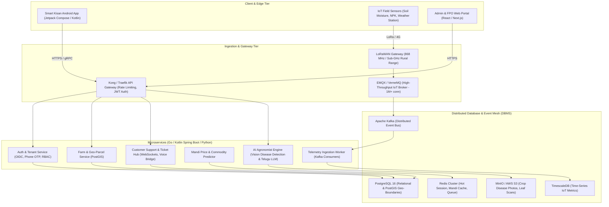
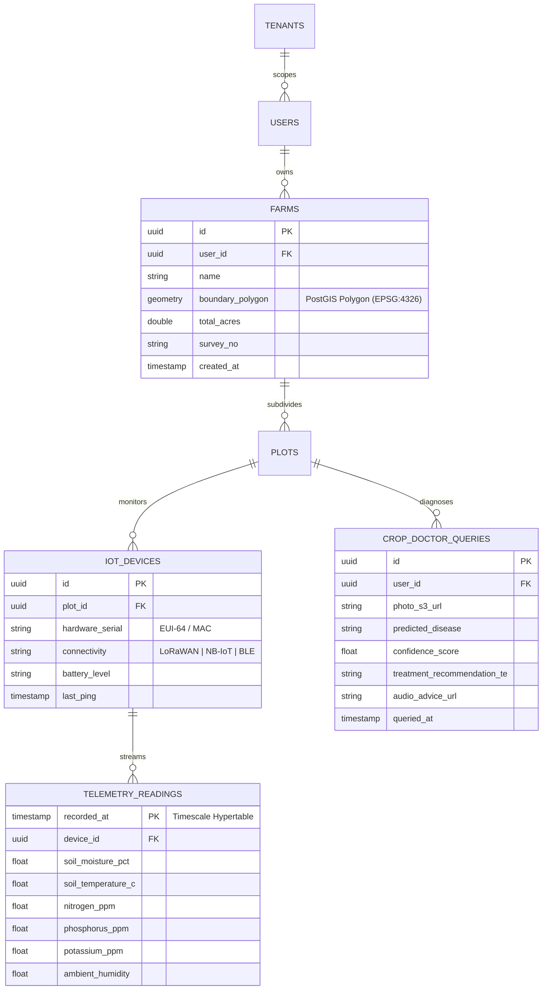
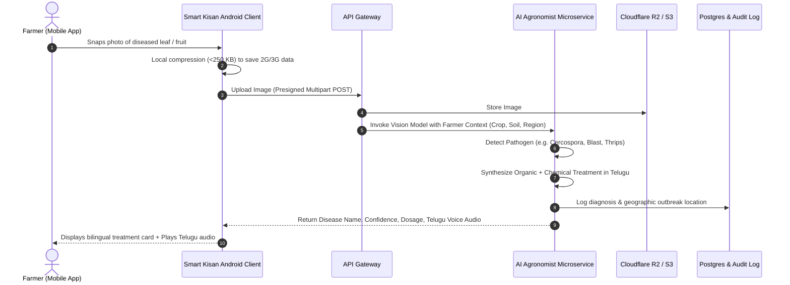
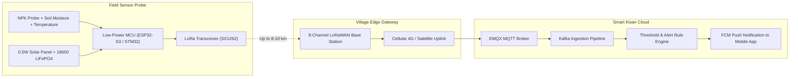
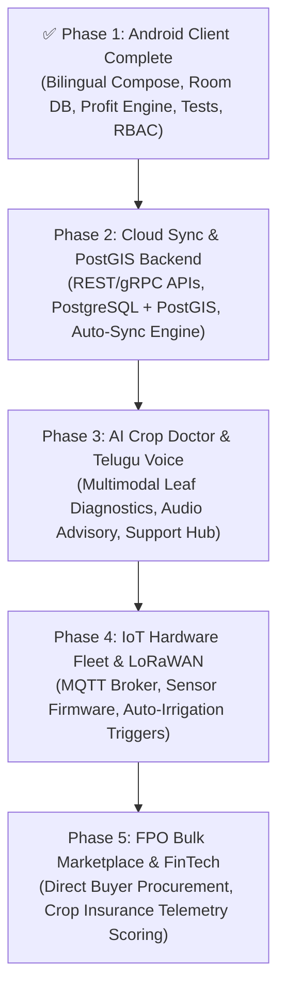

# Smart Kisan (స్మార్ట్ కిసాన్) — Enterprise Scale-Up Blueprint

> [!IMPORTANT]
> **Strategic Objective**: Evolve Smart Kisan from a standalone offline-first mobile app into a scalable, cloud-connected Precision Agriculture & AI Platform supporting hundreds of thousands of concurrent farmers, real-time IoT soil telemetry, multimodal crop disease diagnosis, voice-first vernacular AI, and enterprise data governance.

---

## 1. High-Level Enterprise System Architecture

The target ecosystem transitions to a **Distributed Microservices + Edge-IoT + Cloud Native AI** topology.

---

## 2. Advanced DBMS & Real-time Data Architecture

Handling high-velocity sensor telemetry alongside transactional land records requires a hybrid storage engine:

### 2.1 Storage Segregation Table
| Data Category | Selected Database | Primary Use Case | Scaling Strategy |
|---|---|---|---|
| **Transactional Records** | **PostgreSQL 16** | Users, Tenant RLS, Farm records, Plots, Crop cycles, Expenses | Master-Replica with read pooling (PgBouncer) |
| **Geospatial Parcel Polygons** | **PostGIS Extension** | Survey numbers, GPS land boundaries, satellite NDVI overlay | Spatial R-Tree indexes (`GIST(geom)`) |
| **IoT Sensor Telemetry** | **TimescaleDB** | Moisture, temperature, NPK, solar radiation (millions of rows/day) | Automatic time-based hypertables & 90-day chunk compression |
| **Hot Cache & Rate Limiting** | **Redis 7 Cluster** | Active OTPs, market mandi live cache, user JWT invalidation | In-memory with Redis Sentinel high-availability |
| **Unstructured Media** | **AWS S3 / Cloudflare R2** | Pest/leaf damage photos, voice notes, invoice scans | CDN edge caching with presigned upload URLs |
| **Event Bus & Buffering** | **Apache Kafka** | Decoupling IoT ingestion spikes from database writes | Partitioned by `farm_id` hash |

### 2.2 Relational & Geospatial Schema Evolution (PostGIS)

---

## 3. Real-Time User Management & Customer Support Engine

### 3.1 Multi-Tier Role-Based Access Control (RBAC)
- **Farmer**: Full ownership of personal land, sensor alerts, and financial records; read access to verified agro-inputs and mandi benchmarks.
- **Village Coordinator (Rythu Bharosa Kendra / Extension Officer)**: Aggregated view of village-level crop health, drought alerts, and collective procurement assistance.
- **Agronomist Consultant**: Access to anonymized diagnostic requests; can review AI disease recommendations and approve prescriptions.
- **FPO (Farmer Producer Organization) Manager**: Bulk yield estimation across registered members, forward contract market negotiations.
- **Platform Admin**: System audit logs, sponsor content approvals, IoT hardware fleet health, billing.

### 3.2 Real-time Customer Support Hub
1. **In-App Vernacular Chat & Voice Notes**:
   - Smallholder farmers frequently prefer speaking over typing. Support tickets allow submitting a 30-second audio voice note in Telugu alongside camera pictures.
   - Speech-to-Text automatically transcribes and categorizes the ticket.
2. **WebSockets Live Bridge**:
   - Low-latency real-time bidirectional messaging between farmers and certified extension officers.
3. **Emergency IVR Callback**:
   - Farmers in low-network zones can dial an automated toll-free number that logs an inquiry and triggers an automated agronomist callback.

---

## 4. AI Smart Farming & Multimodal Agronomy Assistant

### 4.1 "Crop Doctor" — Multimodal Disease & Pest Identification

### 4.2 Voice-First Vernacular AI Chat (Telugu & Regional Dialects)
- **Natural Agricultural Conversational Agent**:
  - Leverages fine-tuned LLMs equipped with regional agronomy context (ICAR, ANGRAU, Professor Jayashankar Telangana State Agricultural University advisories).
  - Handles queries like:
    > *"ఈ వర్షానికి నా మిరప తోటలో ఆకు ముడత వస్తుంది, ఏ మందు కొట్టాలి?"*  
    > *(Leaf curl is appearing in my chilli field after rains, which formulation should I spray?)*
  - Generates immediate dosage per acre with safety withholding periods (PHI).

### 4.3 Satellite NDVI & Precision Analytics
- Automated weekly ingestion of European Space Agency **Sentinel-2** 10-meter resolution multispectral imagery.
- Calculates **NDVI (Normalized Difference Vegetation Index)** over the farmer's registered parcel boundaries.
- Alerts farmer to invisible crop stress or water deficits days before physical discoloration occurs.

---

## 5. IoT Sensor Integration Architecture (Low Power, Rural Resilient)

### 5.1 Operational Characteristics:
- **Low Duty Cycle**: Sensor wakes up once every 30 minutes, samples soil moisture and temperature, transmits an 18-byte compressed packet, and returns to deep sleep (<15 $\mu$A sleep current).
- **Zero Ongoing SIM Cost per Sensor**: A single solar-powered LoRaWAN gateway mounted on a village water tower or panchayat building covers an 8 km radius, servicing up to 500 individual farm plots.

---

## 6. Phased Enterprise Scale Roadmap

---

## 7. Sustainable Enterprise Monetization Matrix

1. **Free Smallholder Tier**:
   - 100% free offline farm bookkeeping, crop profit calculator, government mandi rates, and general advisory.
2. **Precision Farmer Pro (₹199 / crop season)**:
   - Unlimited AI leaf disease scans, satellite NDVI vegetation health alerts, hyper-local 3-day weather forecasting.
3. **Agri-Input Marketplace Sponsored Placements (B2B)**:
   - Certified seed, bio-fertilizer, and drone spraying companies bid for contextual sponsored recommendations with mandatory disclosure badges.
4. **FPO & Enterprise SaaS (₹5,000 / month)**:
   - Aggregated harvest forecasting, farmer cluster analytics, and supply-chain track-and-trace for export certification.
5. **FinTech & Crop Insurance Underwriting**:
   - Anonymized soil and yield performance metrics provided to rural banks and PMFBY insurance adjusters to fast-track farmer credit approvals.
